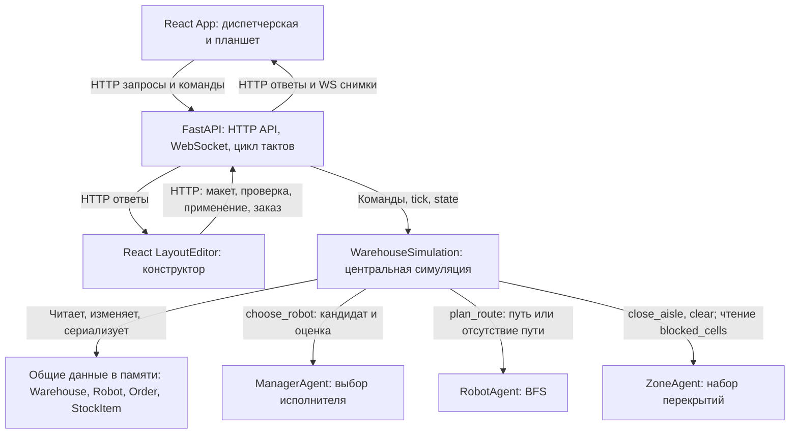

# Фактическая архитектура

Документ описывает реализацию, исследованную на коммите `cf9949b` в ветке `makar`. Целевые изменения вынесены в [план](project-plan.md), состояние и дефекты – в [реестр](docs/project-status.md).

## Компоненты и зависимости

Приложение состоит из браузерного frontend и одного Python-процесса backend. Внешних сервисов принятия решений, брокера сообщений и базы данных нет.

| Файл | Ответственность и зависимости |
| --- | --- |
| [models.py](backend/models.py) | `Point`, `StockItem`, `Order`, `Robot`, `Warehouse`; сериализация dataclass-моделей |
| [agents.py](backend/agents.py) | Использует модели; выбирает ресурс, строит маршрут, хранит перекрытия |
| [layout.py](backend/layout.py) | Использует Pydantic и модели; проверяет макет и создаёт `Warehouse` |
| [simulation.py](backend/simulation.py) | Использует модели и роли; владеет состоянием, применяет назначения и команды |
| [main.py](backend/main.py) | Использует симуляцию и макет; предоставляет API и рассылает снимки |
| [main.tsx](frontend/src/main.tsx) | Запускает React; выбирает `LayoutEditor` при `view=layout`, иначе `App` |
| [App.tsx](frontend/src/App.tsx) | Диспетчерская и планшет; HTTP-команды, подписка на WebSocket |
| [LayoutEditor.tsx](frontend/src/LayoutEditor.tsx) | Редактируемая копия геометрии, проверка, импорт/экспорт и применение |

`backend/main.py` создаёт глобальный `WarehouseSimulation` при импорте. FastAPI lifespan запускает `simulation_loop()`: при `running=true` вызываются `tick()` и рассылка, затем ожидание `TICK_SECONDS=1.0`. Это интервал ожидания между итерациями, а не гарантия точного реального времени. Несколько worker-процессов создадут независимые склады.

Стрелки к ролям обозначают синхронные вызовы и их результат; изменения моделей применяет симуляция. Перекрытия хранятся внутри `ZoneAgent` и передаются симуляцией планировщику вместе с препятствиями и занятостью. Конструктор работает через HTTP, без подписки на WebSocket.

## Модель данных

| Сущность | Значимые поля и смысл |
| --- | --- |
| `Warehouse` | Размер, препятствия, точки забора/отгрузки, списки техники, заказов и товара |
| `StockItem` | ID, название, позиция, размер, статус, `reserved_by` |
| `Order` | ID, название товара, `item_id`, точки, приоритет, статус, `robot_id` |
| `Robot` | ID, позиция, оставшийся маршрут, статус, `order_id`, груз, вместимость, стоянка, фаза и `route_version` |

Координаты – пары `[x, y]` в JSON, отсчёт от нуля из левого верхнего угла; x увеличивается вправо, y вниз. Внутри Python используются кортежи. Движение только между соседними клетками по горизонтали и вертикали. Масштаб в метрах отсутствует.

`Robot.kind` имеет значение `forklift`; это виртуальный погрузчик. Значения размеров `small/medium/large` соответствуют условной загрузке 1/2/3. Вместимость по умолчанию равна 3, но одновременно исполняется только один заказ. Это не модель массы, габаритов или пакетной комплектации.

Заказ, создаваемый через API, одновременно создаёт новую товарную позицию размера `medium` и получает приоритет 1. API не выбирает имеющийся SKU и не позволяет передать размер или приоритет. Он проверяет границы и статические препятствия, но не принадлежность координат рабочим точкам, не текущие перекрытия и не достижимость.

## Назначение и мультиагентность

`start()` и каждый работающий `tick()` вызывают `_assign_orders()`. Заказы `pending` сортируются по убыванию `priority`, затем по ID. Для доступного товара вызывается `ManagerAgent.choose_robot()`.

Кандидат должен не иметь заказа, находиться в фазе `idle`, не быть остановленным и иметь достаточно свободной вместимости. Оценка равна приоритету × 10 за вычетом удвоенного расстояния Манхэттена до товара и условной загрузки. Выбирается наибольшая оценка, при равенстве – меньший ID.

Для одного заказа приоритет и размер одинаковы для всех кандидатов. Поэтому относительный выбор определяется расстоянием и ID, а вместимость действует как фильтр. Фактическая длина пути вокруг препятствий при выборе не вычисляется.

Симуляция записывает назначение, резервирует товар и только затем вызывает построение пути. Недостижимость не отменяет назначения: ресурс может остаться в ожидании с удерживаемым резервом.

В процессе существует по одному объекту `ManagerAgent`, `RobotAgent` и `ZoneAgent`. Они вызываются синхронно центральной симуляцией. `RobotAgent` – общий планировщик; экземпляры `Robot` – данные. Нет отдельных агентных циклов, адресуемых сообщений, переговоров, распределённого состояния или автономного решения каждого робота. Это реализация отдельных ролей будущей мультиагентной системы, а не подтверждение всей исходной концепции.

## Маршруты и конфликты

`RobotAgent.plan_route()` выполняет BFS по четырём направлениям. Запрещены выход за карту, статические препятствия, временные перекрытия и текущие позиции другой техники. Для одинаковой стоимости шага BFS находит кратчайший путь в данном снимке. Возвращаемый список не содержит стартовую клетку; `[]` означает, что старт совпадает с целью, `None` – путь не найден.

На такте погрузчики обрабатываются по ID. Перед каждым шагом маршрут строится заново; занятость обновляется после движения каждого ресурса. При отсутствии пути техника ждёт. Алгоритм не резервирует клетки на будущие такты, не решает глобальную задачу MAPF и не гарантирует отсутствие голодания, взаимной блокировки или бесконечного взаимного перепланирования в узком проходе.

Есть два сценария временного перекрытия:

* Команда водителя закрывает следующую клетку его пути, если она не занята техникой и не совпадает с забором/доставкой **его** заказа.
* Диспетчерская команда ищет внутреннюю клетку пути, для которой существует более длинный обход; это специально подобранная демонстрация.

После перекрытия пересчитываются затронутые маршруты, после открытия проходов – маршруты всех ресурсов. `route_version` увеличивается при этих командах; обычный пересчёт на каждом такте его не увеличивает. `ZoneAgent` хранит набор перекрытий, но координацию вызовов выполняет симуляция.

## Водительский цикл

| Фаза `driver_phase` | Переход и состояние заказа |
| --- | --- |
| `idle` | Назначение резервирует товар, переводит заказ в `assigned`, ресурс в `offered` |
| `offered` | `accept` разрешает фазу `to_pickup`; движение требует запущенной симуляции |
| `to_pickup` | Прибытие переводит в `confirm_pickup`, заказ в `picking` |
| `confirm_pickup` | `pickup` проверяет позицию и резерв, переводит товар в `picked`, заказ в `delivering`, ресурс в `to_dropoff` |
| `to_dropoff` | Прибытие переводит в `confirm_delivery` |
| `confirm_delivery` | `deliver` завершает заказ, ставит товар в `delivered`, снимает резерв и очищает груз; ресурс переходит в `returning` |
| `returning` | Возврат на `home`; по прибытии ресурс становится `idle` |

`status` техники (`idle/moving/waiting/stopped`) и водительская фаза – разные поля. При ожидании принятия или подтверждения техника имеет статус `waiting`.

Команды проверяют текущий ID назначения и индивидуальную остановку; принятие проверяет фазу, забор и доставка – фазу и позицию. Забор дополнительно проверяет резерв и статус товара. В ветке доставки такой повторной проверки резерва нет. Прибытие само по себе не завершает операцию. Пауза симуляции не запрещает корректное подтверждение.

## HTTP API и WebSocket

Обработчики находятся в [main.py](backend/main.py). Все успешные изменяющие команды ниже возвращают полный снимок состояния и публикуют его подписчикам. Проверка макета ничего не изменяет и возвращает только результат проверки. Схемы HTTP доступны в `/docs` и `/openapi.json`. Тело JSON требуется только для создания заказа, водительского действия, проверки и применения макета; остальные POST-команды не требуют тела. У заказа `item` имеет длину 1–80, координаты – пары целых чисел; у водительского действия `order_id` и `action` – строки. Тело макета описано в [DEMO-LAYOUT.md](DEMO-LAYOUT.md).

| Метод | Путь | Назначение |
| --- | --- | --- |
| GET | `/api/state` | Текущее состояние |
| POST | `/api/simulation/start` | Запуск/продолжение и назначение очереди |
| POST | `/api/simulation/pause` | Пауза |
| POST | `/api/simulation/reset` | Сброс прогресса с сохранением выбранного пользовательского макета |
| POST | `/api/simulation/congestion` | Демонстрационное перекрытие с существующим обходом |
| POST | `/api/orders` | Новый заказ и товар: `item`, `pickup`, `dropoff` |
| POST | `/api/robots/{robot_id}/driver-action` | `order_id` и `action`: `accept`, `pickup` или `deliver` |
| POST | `/api/robots/{robot_id}/obstacle` | Перекрытие следующей клетки пути выбранного ресурса |
| POST | `/api/robots/{robot_id}/stop` | Индивидуальная остановка |
| POST | `/api/robots/{robot_id}/resume` | Возобновление и обновление пути |
| POST | `/api/aisles/reopen` | Удаление всех временных перекрытий |
| GET | `/api/layout` | Статический макет |
| POST | `/api/layout/validate` | Проверка: `{"valid":true,"errors":[]}` или список ошибок геометрии |
| PUT | `/api/layout` | Проверка и применение нового макета |
| WS | `/ws/state` | Начальный снимок и последующие полные снимки |

Неизвестный ресурс в командах техники даёт 404; недопустимое водительское действие, невозможный затор или изменение активного макета – 409. Ошибки структуры запроса, координат заказа и применяемой геометрии – 422. У `/api/layout/validate` корректная структура с ошибками геометрии возвращает HTTP 200 с `valid=false`; неверная структура возвращает 422.

Форма снимка:

* `running`, `tick`, `can_create_congestion`.
* `warehouse`: `width`, `height`, `obstacles`, `pickup_points`, `shipping_points`, `robots`, `orders`, `inventory`, `closed_cells`.
* `events`: до 100 записей, новые первыми. Запись содержит `id`, `tick`, UTC-время `time`, `source`, `message`, иногда `robot_id` и `order_id`.
* В сериализованных погрузчиках дополнительно вычисляется `can_report_obstacle`.

WebSocket является каналом снимков к браузеру, не каналом межагентных сообщений. Текст от клиента принимается, но не исполняет команды. При разрыве `App` повторяет подключение через 1800 мс и блокирует свои кнопки команд. Конструктор использует отдельные HTTP-запросы и не подписан на WebSocket.

## Конструктор и сохранение

Контракт JSON v1 и демонстрация описаны в [DEMO-LAYOUT.md](DEMO-LAYOUT.md). `Layout.warehouse()` превращает стены и стеллажи в `obstacles`, стоянки – в погрузчики, создаёт пустые списки заказов и товара. ID техники зависят от порядка стоянок в `cells`.

Применение допускается при `running=false`, нулевом такте и отсутствии заказов со статусом, отличным от `pending`. Поэтому оно может удалить ещё не запущенные заказы. Проверка геометрии и условий выполняется до замены макета. Валидный макет копируется в `custom_layout`, затем `reset()` создаёт склад на его основе.

`reset()` сохраняет `custom_layout`; перезапуск процесса теряет его. Экспорт JSON сохраняет геометрию, типы объектов и ярусы, но не состояние смены. Ярусы не участвуют в движении или товарном учёте. Статическая связность не доказывает отсутствие динамических блокировок.

## Интерфейс, безопасность и измерения

Frontend использует HTTP/WS на имени хоста страницы и порту 8000. CORS разрешает только `http://localhost:5173` и `http://127.0.0.1:5173`. Авторизации и проверки личности водителя нет; CORS не является разграничением доступа.

Диспетчерская показывает последние восемь событий, планшет – до трёх событий выбранного ресурса. Хранилище событий в памяти ограничено ста записями и не является постоянным журналом аудита. CSS обращается к Google Fonts; внешняя модель и внешнее хранилище не используются.

Счётчики интерфейса вычисляются из текущего снимка. Метрик эффективности, длительностей ожидания, измерений производительности и сравнения политик нет. Ограничения интерфейса и сценариев перечислены в [состоянии проекта](docs/project-status.md).
