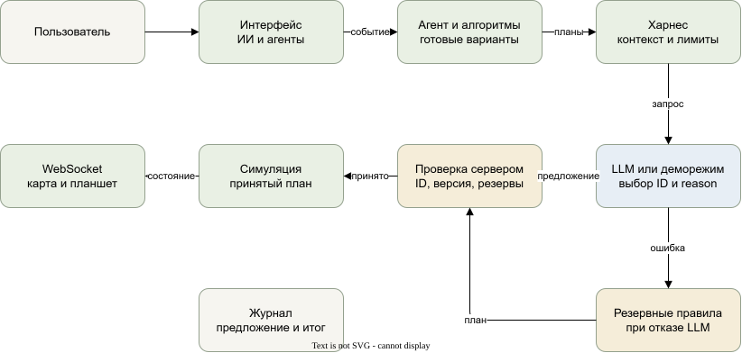

# LLM и агенты: аудит, устройство и работа

Актуализировано 12 ноября 2026 года для рабочей ветки `makar`. Изменения продолжают существующий прототип; ветка, коммиты и удалённый репозиторий не изменялись.

## Что было до изменений

Реальная интеграция уже существовала. `backend/llm.py` отправлял HTTP POST на `https://api.kodikrouter.ru/v1/chat/completions` с моделью `deepseek/deepseek-v4.1-flash-1017`. Ключ `KODIKROUTER_API_KEY` читался сервером. Провайдер, модель, лимит ответа 900 токенов и ожидание 10 секунд были зашиты в код. При наличии ключа сервер автоматически выбирал режим модели.

Модель выбирала готовый пакет назначений, вариант проезда или размещения нового товара. Для вопросов использовались отдельные инструкции помощника и консультанта по технике. Это одна модель с пятью ролями, а не пять независимо обученных моделей. Системные инструкции находятся в `backend/llm.py:INSTRUCTIONS`.

Контекст менеджера содержал ID заказов и погрузчиков, приоритеты, сроки, точки, оценки и длины маршрутов, варианты отбора и остатки. Зоне передавались готовые варианты разъезда и обхода. Размещению передавались габариты коробок, количество и факты о подходящих местах. Помощник получал вычисленные причины ожидания, ограниченный журнал и вопрос пользователя. Полная карта и весь склад в модель не отправлялись.

Вызовов `tool_calls` и доступа к Python, shell, файлам или произвольным API у модели не было. Структурированный ответ содержал `selected` и `reason`; исполнитель проверял ID и актуальность плана перед изменением симуляции. Маршруты BFS, упаковка коробок, резервирование и движения выполнялись алгоритмами. Водитель подтверждал принятие задания, отбор и доставку.

Имелась частичная обвязка: отдельный цикл планирования, инструкции, JSON, проверки и переход на правила. Общего наблюдаемого харнеса, серверной конфигурации модели через интерфейс, проверки подключения, отдельного деморежима и истории запросов не было. Журнал восьми решений и счётчики хранились в памяти. Лимит шести запросов действовал только в сравнительной демосмене; обычная смена не имела общего бюджета и паузы после ошибок API. Ошибки сводились к логам без удобной диагностики. `AGENTS.md` и README ошибочно утверждали, что LLM нет. Подпись DeepSeek использовалась независимо от источника объяснения.

## Что изменено

`backend/harness.py` объединяет настройки, реестр разрешённых операций, формирование запроса, жизненный цикл, структурную проверку, бюджеты и историю. Путь реального назначения сохранён в `backend/planning.py` и `backend/dispatch.py`; новая параллельная система агентов не создавалась.

Харнес обслуживает одну операцию одновременно: ожидание события → запрос → предложение или ошибка → проверка исполнителем → применение или отказ. Завершение запроса, отмена и ошибки освобождают состояние занятости. На ошибку транспорта, HTTP, JSON или неизвестный ID назначается пауза 30 секунд. Автоматических повторов с дополнительными расходами нет; дальнейшее событие может инициировать новый запрос после паузы. Неизменный контекст менеджера или зоны не запрашивается чаще раза в 30 секунд. Смена и сравнение имеют разные отпечатки контекста. При смене режима ответ находящегося в работе запроса отклоняется. Результат, полученный после паузы или сброса склада, также не может назначить задание.

Реестр в `TOOLS` содержит `select_assignment_plan`, `select_zone_plan`, `select_storage_plan`, `explain_vehicle`, `answer_dispatcher`. Это разрешённые операции харнеса, а не произвольные функции, вызываемые моделью через API tools. Для первых трёх модель возвращает один ID существующего плана; для двух консультантов возвращает пустой массив ID и текст. Вызов исполнительного метода разрешает сервер. Самостоятельных процессов каждого робота, обмена сообщениями между моделями и свободного цикла «думать и вызывать инструменты» нет. Такое ограничение позволяет объяснить и проверить каждое действие. Внешний агентский фреймворк не добавлен: существующих `asyncio`, httpx и Pydantic достаточно для этого ограниченного сценария.

На сервере теперь есть OpenAI-совместимый адаптер для JSON Chat Completions. Совместимость конкретного провайдера, идентификатора модели, JSON-режима и temperature требуется проверить его документацией и кнопкой подключения. Перечень в настройках задаёт владелец сервера; это не автоматически проверенный каталог моделей. По умолчанию сохранён прежний идентификатор DeepSeek через KodikRouter, его доступность реальным запросом в этой работе не подтверждалась.

В интерфейсе «ИИ и агенты» доступны настройки, состояние, метрики, мониторинг ролей и погрузчиков, журнал и подробности контекста. Источник решения явно указан: модель, демонстрация, правила или резервный алгоритм. Текст `reason` является объяснением модели, а не доказанной историей вычисления. Фактические маршруты, оценки и результаты применения показываются отдельно. Стоимость не рассчитывается: достоверные тарифы не настроены.

## Распределение ответственности

| Компонент | Что делает |
| --- | --- |
| Менеджер и алгоритмы склада | Формируют ограниченный набор совместимых назначений с учётом товара, сроков, приоритета и техники |
| LLM в роли менеджера | Выбирает пакет из предложенных ID и объясняет выбор |
| Геометрия хранения | Проверяет габариты, высоту, свободную поверхность и пересечения коробок |
| LLM в роли размещения | Выбирает среди рассчитанных размещений нового товара, когда есть несколько вариантов |
| Алгоритмы проездов | Находят BFS-маршруты и ограниченный набор разъездов; проверяют занятость каждого шага |
| LLM в роли зоны | Выбирает среди готовых разъездов или обходов |
| Симуляция | Проверяет актуальное состояние, резервы, вместимость и ID; исполняет принятый план |
| Водитель | Принимает задание и подтверждает отбор и доставку |
| Помощник и консультант по технике | Отвечают по снимку фактов и дают рекомендации; не меняют склад |

Точное движение, предотвращение совпадения клеток, физические ограничения и упаковку переносить в LLM не следует. Глобальная оптимальность, разрешение любого тупика и безопасность реальных погрузчиков не гарантируются существующим клеточным симулятором. Стратегии, изменение приоритетов и переназначение из текста не добавлены: консультант остаётся интерфейсом вопросов по фактам. Высокоуровневое назначение уже даёт полезное, проверяемое участие модели без дополнительных команд управления.

## Путь одного решения

Пользователь запускает смену → `assignment_loop()` замечает свободную технику → `dispatch.assignments()` создаёт варианты и совместимые пакеты → харнес формирует контекст менеджера → HTTP-запрос к LLM → проверка JSON и ID → `dispatch.apply_assignments()` пересчитывает актуальные варианты, проверяет версию, уникальность техники и совместные резервы → `simulation.apply_assignment()` закрепляет товар и предлагает задание водителю → WebSocket обновляет карту и панели.

Если проверка не прошла, назначения рассчитываются правилами. Пока API отвечает, отдельный цикл тактов продолжает работу; на каждый кадр анимации запросы не отправляются. В журнале отдельно видны предложение и итог применения. Нативная редактируемая схема находится рядом: [llm-architecture.drawio.svg](llm-architecture.drawio.svg).



## Термины без предварительных знаний

LLM – языковая модель, которая получает текстовые данные и генерирует ответ. API – интерфейс обращения к другому сервису. API-ключ – секрет, позволяющий серверу обращаться к провайдеру и расходовать его квоту. Провайдер – сервис, обслуживающий модель; его название и название самой модели могут отличаться.

Агент – программная роль с задачей, контекстом и доступными действиями. Харнес – обвязка вокруг роли и модели: когда вызвать, что передать, какой ответ разрешён, кто проверяет действие и что делать при ошибке. В нашем проекте модель выбирает план, а сервер решает, можно ли его применить.

## Запуск без ключа

1. Запустите backend и frontend по `DEVELOPMENT.md`, откройте `http://127.0.0.1:5173`.
2. Откройте «ИИ и агенты». При отсутствии ключа будет написано «Ключ не задан на сервере».
3. В поле «Планирование» оставьте «Алгоритмы» для обычной работы либо выберите «Демонстрация без LLM».
4. Закройте панель клавишей Escape, нажмите «Запустить». В демонстрации программа выбирает первый допустимый вариант через тот же харнес и проверки, без сетевого запроса.
5. Откройте «Планшет водителя», выберите нужный погрузчик и принимайте задания, подтверждайте отбор и доставку. Вернитесь в диспетчерскую, откройте журнал.

Демонстрация проверяет интерфейс и цикл исполнения. Она не доказывает, что настоящая модель лучше распределяет заказы.

## Подключение своей модели

1. Скопируйте `.env.example` в `.env` в корне `makar`. `.env` исключён из Git; не присылайте его содержимое в отчётах.
2. В локальном файле задайте `LLM_API_KEY`, `LLM_BASE_URL` с окончанием `/v1`, название провайдера `LLM_PROVIDER` и точный ID `LLM_MODEL`. Для прежнего запуска поддерживается `KODIKROUTER_API_KEY`, если `LLM_API_KEY` не задан. Пустой явно заданный `LLM_API_KEY` отключает старый ключ.
3. Перечислите доступные вашей учётной записи ID через запятую в `LLM_MODELS`. Не вписывайте произвольные названия из примеров, если провайдер их не поддерживает. Начальная модель также включается в список.
4. Запустите backend с локальным файлом. Перезапуск удаляет состояние текущего склада и историю; завершите текущую демонстрацию заранее:

```powershell
.\.venv\Scripts\python.exe -m uvicorn backend.main:app --host 127.0.0.1 --port 8000 --env-file .env
```

5. В «ИИ и агенты» раскройте «Подключение и настройки». Выберите модель и нажмите «Применить настройки». Раздел «Параметры и лимиты» управляет реальными аргументами запросов. Temperature по умолчанию не передаётся; оставьте пустым, если модель не поддерживает этот параметр. Для прежнего API KodikRouter сохранён параметр отключения thinking; `LLM_DISABLE_THINKING=false` отключает эту серверную добавку. Для других адресов она не передаётся. JSON-режим можно отключить для несовместимого провайдера, однако модель всё равно обязана вернуть корректный JSON.
6. Нажмите «Проверить подключение». Это один настоящий запрос, который может стоить денег; он расходует общий лимит. Зелёной гарантии по наличию ключа нет: до успешного ответа отображается «Подключение ещё не проверено».
7. Выберите «Модель» в «Планирование» и запустите смену. Само наличие ключа не запускает LLM автоматически: начальный режим всегда «Алгоритмы».
8. В журнале найдите источник LLM, полученное предложение и результат «Принято: назначения применены и товар зарезервирован». На планшете должны появиться соответствующие задания. Счётчик реальных запросов должен увеличиться.

Модель и параметры, изменённые в интерфейсе, действуют до перезапуска. Для постоянных значений используйте серверный `.env`: `LLM_MAX_TOKENS`, `LLM_TIMEOUT`, `LLM_REQUEST_LIMIT`, `LLM_TOKEN_LIMIT`, `LLM_TEMPERATURE`, `LLM_JSON_MODE`. Адрес API и ключ намеренно не редактируются в браузере. Для локального совместимого сервера, требующего условный ключ, задайте его только серверной переменной.

## Журнал и ограничения расходов

«История обращений» показывает время, роль, источник, причину вызова, задержку, предложение, ошибку и результат проверки. «Контекст и результат» загружает подробности с сервера, включая системную инструкцию и параметры реального запроса. Секретный ключ из заголовка авторизации туда не записывается; известное значение ключа в тексте заменяется на `[скрыто]`. Заголовки и тела HTTP-ошибок провайдера не публикуются. Не вводите другие секреты и персональные сведения в вопрос: контекст и ответы доступны локальным пользователям приложения и сохраняются в памяти.

Последние 100 обращений хранятся в памяти процесса, включая сравнительные прогоны. Сброс склада не обнуляет бюджет харнеса. Перезапуск сервера удаляет историю и счётчики. Настройки бюджета можно увеличить вручную; они не заменяют лимиты расходов в кабинете провайдера.

По умолчанию разрешено 50 реальных запросов за запуск сервера. Перед вызовом резервируется `max_tokens`, после ответа учитывается более высокий фактический расход, если он возвращён. Это ограничитель новых запросов, а не точный потолок денег: заранее неизвестны входные токены, скрытые токены и тариф. Если провайдер не возвращает usage, интерфейс показывает количество таких ответов; фактические токены не выдумываются. Сравнительная демосмена дополнительно ограничена шестью реальными запросами. При исчерпании бюджета планирование продолжится по правилам.

## Ошибки и восстановление

| Наблюдение | Действие |
| --- | --- |
| Ключ не задан | Проверьте имя переменной, `.env` и `--env-file`; перезапустите сервер |
| 401 или 403 | Проверьте ключ, права и доступ к выбранной модели у провайдера |
| 429 | Дождитесь окончания паузы; проверьте квоту и баланс у провайдера |
| Нет связи или таймаут | Проверьте доступность API; увеличьте ожидание при необходимости; склад может работать по правилам |
| Некорректная структура или ID | Откройте контекст и результат; проверьте поддержку JSON и модель; неизвестные ID сервер отклоняет |
| Запрос пропущен | Возможны общий бюджет, другой активный запрос или пауза после ошибки; статусы видны в панели |
| Модель в списке отсутствует | Добавьте точный ID в серверный `LLM_MODELS` и перезапустите сервер |
| Заказ ждёт подтверждения | Перейдите на планшет водителя; LLM не заменяет подтверждения |
| Пояснение расходится с фактами | Ориентируйтесь на вычисленные данные и результат проверки; текст модели может ошибаться |

Для повторной проверки используйте «Проверить подключение» после окончания паузы. Для повторного анализа задайте вопрос помощнику. Кнопка произвольного повторного исполнения старого плана не добавлена: старое состояние может быть недействительным.

## Что показывать преподавателю

1. Без ключа: «ИИ и агенты» → «Демонстрация без LLM» → «Сравнить демонстрацию и алгоритмы». Сравнение выполняется в отдельных складах и не меняет текущую смену. Оба прогона получают четыре одинаковых заказа, автоматические водительские подтверждения и перекрытие `[5, 3]` с такта 2 до такта 12, максимум 80 тактов.
2. Покажите числа завершённых заказов, расстояние, ожидание и время прогона. Время включает ожидание ответа модели, но не является реальной длительностью смены: сравнительные такты вычисляются ускоренно. Отдельного счётчика конфликтов пока нет; ожидание не следует называть количеством столкновений.
3. При настроенном реальном API выберите «Модель» и повторите сравнение. Покажите журнал LLM, структурированный выбор ID и принятие или отказ сервера. Если были только переходы на правила, это не демонстрация успешного участия LLM.
4. В текущей смене покажите полученное назначение, принятие на планшете, движение, отбор и доставку. Задайте вопрос «Почему этот погрузчик простаивает?» с выбранным ID.
5. Объясните: «Харнес готовит факты и ограничивает доступные решения. Модель выбирает готовый план. Сервер проверяет актуальность, ресурсы и резервы. Симуляция выполняет принятый план, водитель подтверждает действия».

Один прогон не доказывает оптимизацию. Для такого вывода нужны повторяемые эксперименты на наборе одинаковых сценариев с учётом задержки, ошибок, затрат и переходов на правила. Корректный результат защиты сейчас – показать измеряемое участие модели и контролируемое исполнение.

## Файлы и API

Также обновлены `AGENTS.md`, `README.md`, `DEVELOPMENT.md`, `architecture.md`, `docs/project-status.md`; добавлены эта инструкция и редактируемая схема. Ранее существовавшие изменения других частей склада сохранены.

Основные файлы: `backend/harness.py`, `backend/llm.py`, `backend/planning.py`, `backend/dispatch.py`, `backend/main.py`, `backend/simulation.py`, `frontend/src/AIControl.tsx`, `frontend/src/DispatchPanel.tsx`, `frontend/src/dispatch.css`, `frontend/src/App.tsx`, `tests/test_harness.py`, `.env.example`.

Существующие API склада, водительские фазы и поля сохранены. В `dispatch` снимка добавлены `ai` и `agents`; режим допускает `rules`, `model`, `demo`. Настройки: GET/PUT `/api/dispatch/settings`. Проверка: POST `/api/dispatch/test`. Подробности обращения: GET `/api/dispatch/history/{id}`. Вопрос: POST `/api/dispatch/ask`. Сравнение: POST `/api/dispatch/compare`.

Frontend остаётся клиентом backend: секрет живёт только на сервере. Один статический хостинг не запускает Python и не подходит для хранения ключа. Для публикации необходимы сервер, HTTPS/WSS, настройка адресов и CORS, авторизация и ограничения доступа к затратным API. Существующий прототип рассчитан на локальный запуск, не на публичное использование. URL API и ключ не разрешены в браузерных настройках.

## Проверка реализации

Автоматические проверки используют `httpx.MockTransport`, не платный API. Проверяются успешное назначение, настройки запроса, списки ID, смена режима во время ответа, пауза, ошибки сети, реальные asyncio-таймауты, HTTP 401/403/429/500, ошибочный JSON, отсутствие usage, бюджеты после сброса, отмена, подавление повторов, демоцикл без транспорта, API настроек, просмотр истории и исключение ключа из ответов.

12 ноября 2026 года: `python -m unittest discover -s tests -q` через `.venv` – 70 тестов прошли. `npm --prefix frontend run build` – TypeScript и Vite собраны успешно. `git diff --check` – без ошибок форматирования. Зависимости не менялись. В окружении есть предупреждение Starlette о будущем переходе тестового клиента с httpx на httpx2; оно не мешает текущим проверкам.

В браузере проверены режимы, сохранение параметров, демонстрационный вопрос, отдельное сравнение, появление его истории без дополнительных действий и загрузка подробного контекста. Через планшет полностью выполнен один заказ: принятие, движение, отбор и доставка. Панель проверена при ширине 390 и 1440 пикселей, горизонтального переполнения нет. Исправлен обнаруженный при просмотре контраст полей в тёмной теме. В консоли браузера ошибок нет. Реальная доступность KodikRouter и указанной модели без ключа не проверена. Произвольные провайдеры и все их расширения не проверены. Постоянное хранение истории, глобальная оптимизация, денежный биллинг, независимые процессы агентов и управляющий чат не реализованы.
